# MovieLand

A React + Vite movie discovery app: search and filter a built-in sample catalogue of 61 films (no account, works offline), keep named lists, rate and review what you watch, log a viewing diary, see stats, get recommendations, plan a movie night and play a quiz. Paste your own [OMDb](https://www.omdbapi.com/) key to switch to live search of the full database.

It is a pure static app: no server, no backend, nothing embedded. Everything you create is stored in your own browser.

**Live preview:** https://shishir19999.github.io/Movieland-api/

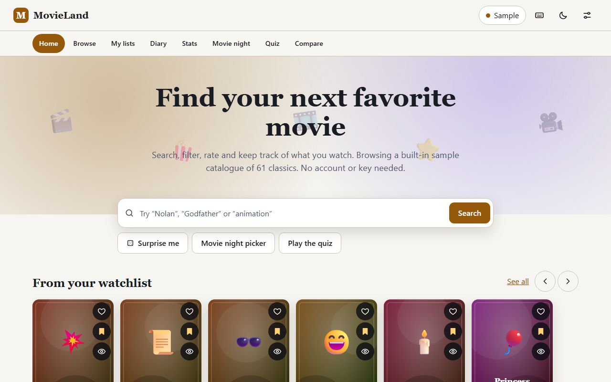

## Features

**Discover**
- Home page with curated rows: featured this week, top rated, hidden gems, under 100 minutes, world cinema, browse by decade, directors to explore, "from your watchlist" and "because you liked ..." recommendations
- Search with title suggestions and recent searches; matches titles, directors and cast
- Advanced filters: multiple genres (match all or any), decade, year range, runtime range, rating range, language, seen or not seen; sort by relevance, rating, year, runtime or title
- Infinite scroll with a Load more button as a fallback, skeleton loaders, empty and error states
- Details dialog: plot, cast and director (linked to people pages), ratings, trailer search link, similar films, shareable link (`#/m/<id>`)
- People pages with a filmography and frequent collaborators
- Compare two films side by side (year, runtime, rating, genres, shared cast, a similarity score)
- "Surprise me" random pick

**Your library**
- Named lists: Watchlist, Favorites, Watched plus any custom lists; reorder by drag and drop or with the move buttons
- Ratings (1 to 5 stars) and private notes per film
- Diary of dated viewings that you can edit, filter by year and export
- Stats page: films and hours watched, average rating, genres, decades, runtime, languages, viewings per month, top directors and actors. Every chart is a list of real text values, so it reads the same for screen readers
- Export and import everything as JSON; lists and diary as CSV; share any list by link and save a shared list to your own
- Movie night picker: choose sources (catalogue or your lists), limits (runtime, genre, rating, skip seen films), get a shortlist, let it decide, and share the shortlist link
- Guess-the-movie quiz with five question types, streaks and a saved best score

**App**
- Installable PWA that works offline, including under the GitHub Pages sub-path
- Keyboard shortcuts with a help dialog (press `?`)
- Light and dark theme (follows the system, remembered), responsive from 320px, parallax hero that respects reduced motion
- Accessibility: skip link, focus moved to the page heading on navigation, focus trap and restore in dialogs, live announcements, no colour-only meaning. The pages are checked with axe

| Browse and filter | Details dialog |
| --- | --- |
| 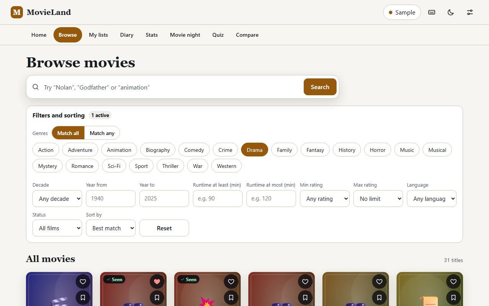 | 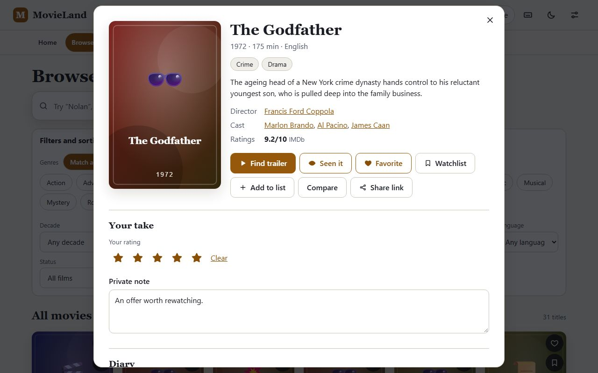 |
| **Lists** | **Stats** |
| 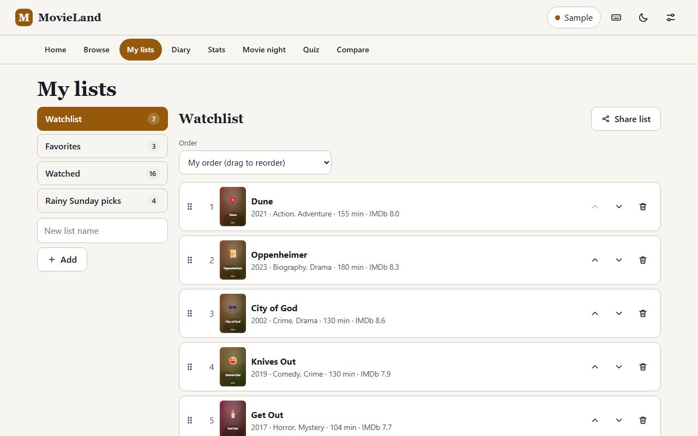 | 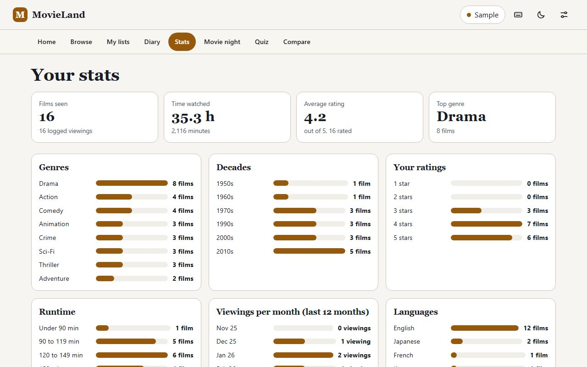 |
| **Compare** | **Movie night** |
| 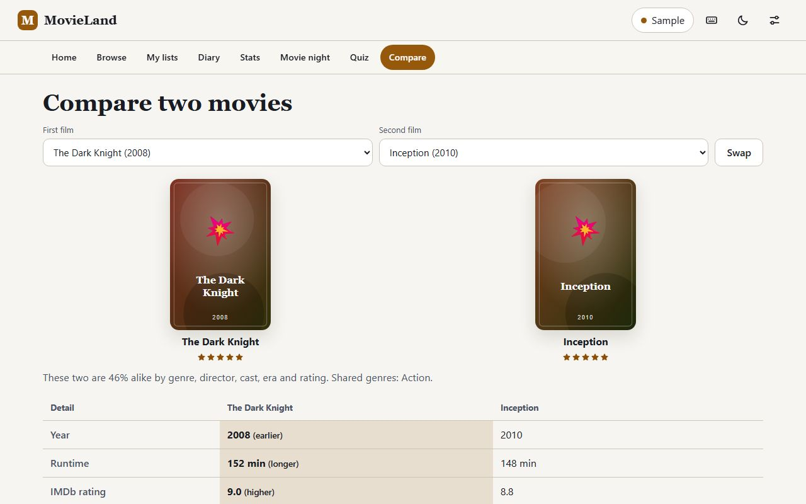 | 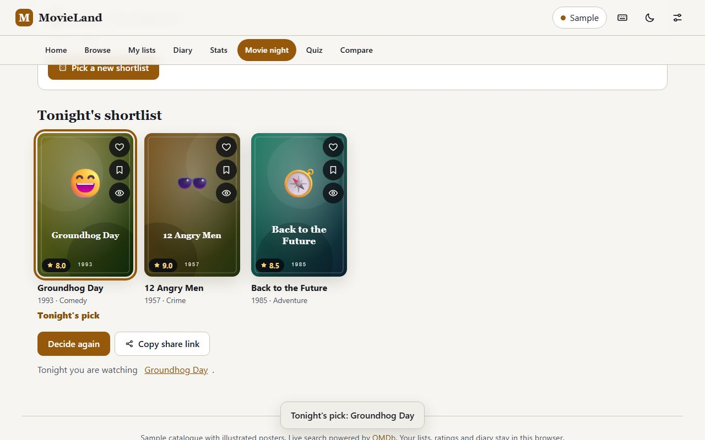 |

On a phone:

<p>
  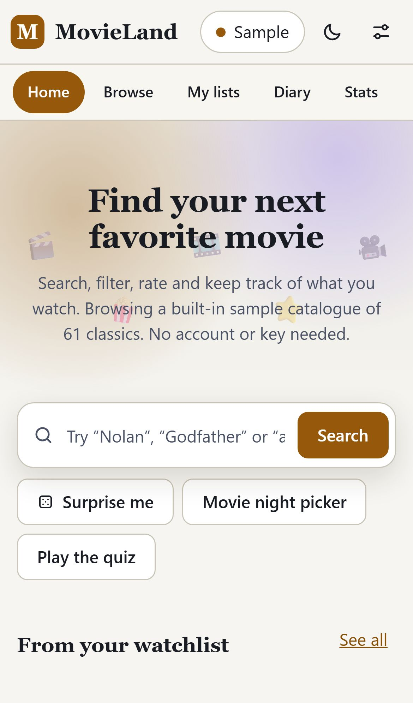
  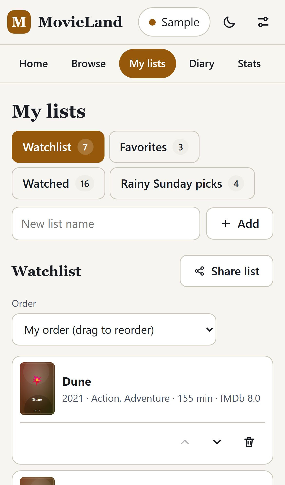
  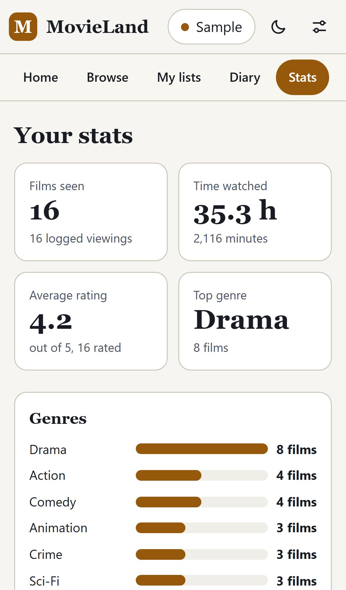
  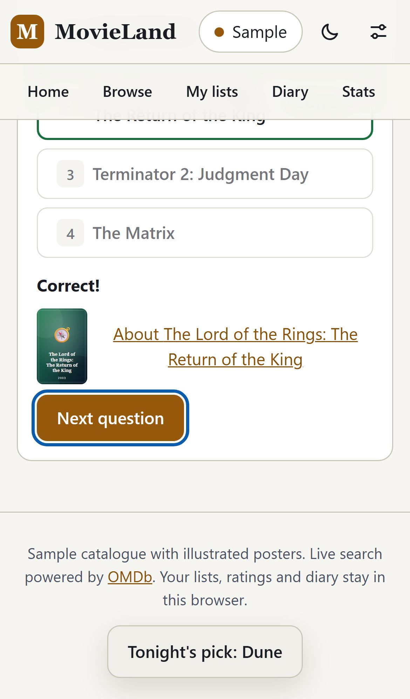
</p>

More shots are in [docs/screenshots](docs/screenshots) (dark theme, diary, people page).

## Keyboard shortcuts

| Key | Action |
| --- | --- |
| `/` | Search |
| `?` | Show the shortcuts dialog |
| `t` | Switch light or dark theme |
| `r` | Surprise me |
| `g` then `h` `b` `l` `d` `s` `n` `q` `c` | Go to Home, Browse, My lists, Diary, Stats, Movie night, Quiz, Compare |
| `f` `w` `s` | In a movie dialog: favorite, watchlist, seen |

## Run locally

```bash
npm install
npm run dev          # http://localhost:5173
npm test             # unit tests (vitest) for the data, library, stats, quiz and routing logic
npm run lint
npm run build        # production build into dist/
npm run build:pages  # GitHub Pages build (base /Movieland-api/) into dist/
```

## Using your own OMDb key

1. Get a free key at https://www.omdbapi.com/apikey.aspx
2. Either open **Settings** (gear icon, or the Sample/Live pill) in the app and paste it. It is stored only in your browser's localStorage and sent only to omdbapi.com.
3. Or, for local builds, copy `.env.example` to `.env` and set `VITE_OMDB_KEY`. `.env` is git-ignored. The `build:pages` script ignores `.env` and never embeds a key, so the published site can only use a key a visitor enters.

With a key, Browse searches the live database (type and year filters, infinite scroll); a switch lets you go back to the sample catalogue for the advanced filters. Live titles you save are kept in your lists with the details needed to show them offline.

## Your data and backups

Lists, ratings, notes and the diary live in `localStorage` under `ml:lib`. Use **My lists > Backup and restore** to download a JSON backup (restore it by merging or replacing), or CSV files for lists and the diary. CSV exports neutralise spreadsheet formulas, and imports validate every field, so a bad file cannot corrupt your library. Earlier favorites and watchlist data are migrated automatically.

## Offline and install

A service worker (generated at build time, scoped to the app's base path) precaches the app shell and the bundled catalogue, so after one visit the app opens and works offline. Live OMDb search and external poster images still need a connection. Use your browser's install option, or the "Install the app" link in the footer where available.

## Project layout

```
src/lib/        pure logic: filters, library (lists, diary, import/export), recommendations,
                stats, quiz, movie night, routing, OMDb client  (all unit tested)
src/pages/      Home, Browse, Lists, Diary, Stats, Person, Compare, Night, Quiz, Shared
src/components/ cards, rows, dialogs, filters, charts, stars
sw/             service worker template (filled in by the build)
```

## Parallax and motion

The hero banner parallax, scroll-reveal rows and poster tilt use only `transform` and `opacity`, driven by IntersectionObserver and requestAnimationFrame with no libraries. They are disabled under `prefers-reduced-motion` and on small or low-power screens.
